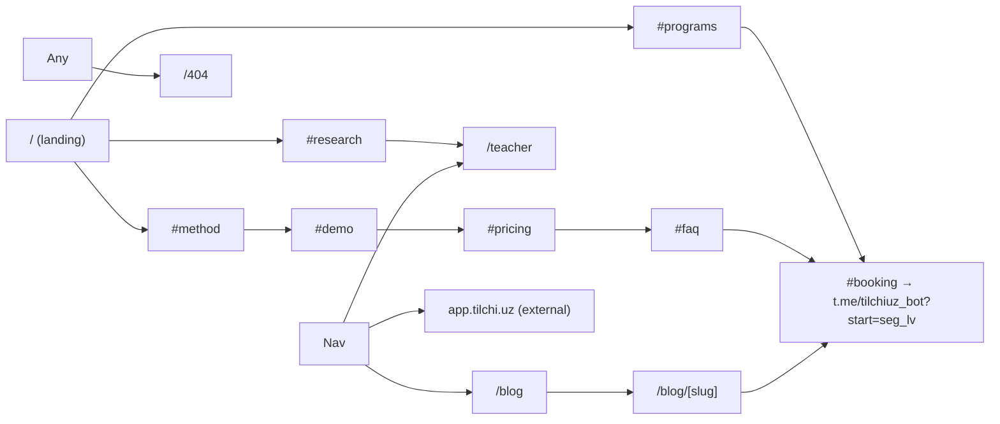
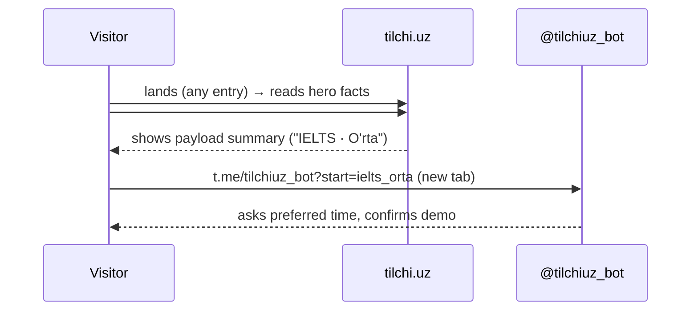

> Phase 1 note (2026-10-27). The live `/` route is a thin Kunduzgi hero plus the Telegram CTA. Do not render a cohort label. Full S-01 sections stay in this spec for a later port. `/app/meet` may use ink-dark tiles later. Phase 1 does not build that route. App tokens live in `apps/web/src/styles/tokens.css`.

# tilchi.uz — design specification

Version 3.0 · 2026-10-23 · direction **"Kunduzgi studiya"** (daylight studio)

Scope: the marketing site in this repo (`tilchi/`, Next 16 static export). `app.tilchi.uz` (classroom app, separate repo) is out of scope. This file is the single source for the redesign; section files reference it.

Contents: 00 Overview · 01 Color · 02 Type · 03 Foundations · 04 Components · 05 IA · 06 Screens · 07 Flows · 08 Copy · 09 Responsive · 10 Motion · 11 A11y · 12 Handoff · 13 Roadmap · 14 Decision log

---

## 00 Overview

**Product.** One English teacher (Mukhtasar Karimjonova, IELTS 7.0 / CEFR C1, linguistics MA, published researcher) sells online lessons in three tracks — Bolalar (5–14), IELTS, Kattalar (18+). Conversion is a free 30-minute demo booked through a Telegram bot (`@tilchiuz_bot`, deep link carries segment + level). Pricing is "kelishuv asosida" (by agreement); numbers are stored but not shown.

**Audience.** (1) Parents in Uzbekistan choosing a tutor for a child — want trust, safety, visible progress. (2) Adults preparing for IELTS — want proof of competence and a method. (3) Working adults who need speaking — want flexibility.

**Business goal.** Demo bookings. Every screen ends in `/#booking`.

**Why redesign.** v2 (cream + terracotta editorial) is competent but reads as the common "warm AI editorial" template: centred hero + shadowed card, three stacked icon cards, accordion FAQ, pill buttons, pill badges, bordered cards everywhere. v3 replaces the *structure*, not just the palette: typographic hero, index-style lists with hairlines, no shadowed cards, one accent.

**Principles.**
1. Paper, ink, one green. Nothing else gets colour.
2. Hairlines over boxes. Hierarchy from type size and space, not borders + shadows.
3. Asymmetry on purpose. Section headers sit left; content grids are 7/5 or 5/7, never 3 equal cards.
4. Numbers are tabular, large, serif. They are the proof.
5. Motion is restrained and reversible; everything respects `prefers-reduced-motion`.
6. Keep what works: data modules (`src/lib/domain`, `src/lib/site.ts`), SEO adapter, GSAP helpers, view transitions, build gates.

**Verified facts** (from repo): stack, data modules, gates (`check-contrast`, `check-js-budget` 320 KB gzip), no teacher photo asset exists, no Tailwind utility classes are used in components.
**Assumptions** (need owner confirmation): a real portrait photo will be supplied later (slot is built, fallback is a typographic monogram); copy stays Uzbek-only; "Birinchi oqim — 2026 avgust" label is still current.

---

## 01 Color

Single warm-neutral family tinted toward green; one accent (forest green, S≈59%). No second accent. Telegram blue appears only as the icon glyph, never as a surface.

### Semantic tokens (`:root` in `src/app/globals.css` — `scripts/check-contrast.mjs` reads this block, keep it flat)

| Token | Hex | Role |
|---|---|---|
| `--bg` | `#FCFCFA` | canvas (paper) |
| `--bg-elev` | `#FFFFFF` | raised surface (rare) |
| `--bg-alt` | `#F1F3EE` | alternate band / hover row |
| `--surface` | `#FFFFFF` | inputs, choice chips |
| `--ink` | `#151A17` | primary text, ink buttons |
| `--ink-2` | `#3B423E` | body text |
| `--muted` | `#666E68` | secondary text (≥4.6:1 on all bgs) |
| `--line` | `#E1E5E0` | hairline |
| `--line-strong` | `#C4CBC5` | hairline on hover / dividers in dense lists |
| `--accent` | `#1E6B47` | underlines, markers, icons (6.3:1 on bg) |
| `--accent-solid` | `#175A3B` | primary button bg (8.2:1 with white text) |
| `--accent-2` | `#0F4A2F` | primary button hover |
| `--accent-soft` | `#E1EEE4` | tinted panels (booking panel, portrait fallback) |
| `--accent-ink` | `#0C3F27` | text on `--accent-soft` (9.9:1) |
| `--success` | `#1E6B47` | check icons (= accent) |
| `--tg` | `#2AABEE` | Telegram glyph only |
| `--focus` | `#175A3B` | focus ring |

Light content theme with no dark-mode toggle (parents on phones in daylight; one theme keeps the contrast gate meaningful). The `/app` desktop sidebar uses existing ink-dark tokens as a fixed shell surface. `::selection` = `--accent-soft`.

Rules: never put `--accent` text smaller than 0.875rem on `--bg-alt`; never use pure `#000`; shadows carry ink tint `rgba(21,26,23,α)`.

---

## 02 Typography

| Role | Family | Size token | Weight | Line-height | Tracking |
|---|---|---|---|---|---|
| Display (hero h1) | Fraunces (opsz, SOFT axes) | `--fs-display` = clamp(3rem, 7.4vw + 0.6rem, 6.8rem) | 400 | 0.98 | −0.035em |
| H2 | Fraunces | `--fs-h2` = clamp(2rem, 3.4vw + 0.6rem, 3.5rem) | 400 | 1.02 | −0.028em |
| H3 | Fraunces | `--fs-h3` = clamp(1.35rem, 1.4vw + 0.8rem, 1.75rem) | 450 | 1.15 | −0.015em |
| Lead | Geist | `--fs-lead` = clamp(1.125rem, 0.5vw + 0.95rem, 1.3125rem) | 400 | 1.5 | 0 |
| Body | Geist | `--fs-body` = 1.0625rem | 400 | 1.6 | 0 |
| Small | Geist | `--fs-sm` = 0.9375rem | 400/500 | 1.5 | 0 |
| Caption | Geist | `--fs-xs` = 0.8125rem | 500 | 1.45 | 0 |
| Label (`.eyebrow`) | Geist | `--fs-label` = 0.75rem | 600 | 1 | +0.12em, uppercase |
| Big number (`.stat`) | Fraunces | clamp(2.25rem, 3vw, 3rem) | 400 | 1 | −0.03em, tabular |

Fonts load via `next/font/google` (`Fraunces` with `axes: ['opsz','SOFT']`, `Geist`). Italic Fraunces is the only emphasis inside headings (`em` = italic, colour `--accent`). Body `p` max-width 64ch, `text-wrap: pretty`; headings `text-wrap: balance`. `.num` → `font-variant-numeric: tabular-nums`. Uzbek apostrophe is `'` (U+0027) in copy; do not convert.

---

## 03 Foundations

- **Spacing**: 4px base. Section padding `clamp(72px, 9vw, 136px)` top, `clamp(80px, 9.6vw, 148px)` bottom (optically heavier bottom). Inner rhythm 8/12/16/24/32/48.
- **Container**: `--container: 1200px`, side gutter `clamp(16px, 4vw, 40px)`.
- **Grid**: 12 columns, gap 24px (`.grid-12`). Common splits: 7/5, 5/7, 4/8.
- **Radius**: `--r-sm` 6px (tags), `--r-md` 12px (buttons, inputs, chips), `--r-lg` 20px (panels), `--r-xl` 28px (portrait), `--r-full` 999px (only the progress dot).
- **Borders**: 1px `--line`. Hairline rows: `border-top: 1px solid var(--line)`; last row also gets `border-bottom`.
- **Elevation**: `--sh-panel: 0 24px 48px -28px rgba(21,26,23,0.25)` — used only on the portrait and the booking panel. `--sh-focus: 0 0 0 3px rgba(23,90,59,0.35)`.
- **Z-index**: grain 1 · sticky CTA 90 · nav 100 · progress 101 · skip 200.
- **Breakpoints**: ≤520 phone-small · ≤780 phone/menu · ≤920 tablet (grids collapse) · ≥921 desktop.
- **Icons**: inline SVG, 1.75 stroke, 16/20/24px, `currentColor`. No icon library.
- **Focus**: `:focus-visible` 2px solid `--focus`, offset 3px.
- **Touch targets**: ≥44px.
- **Motion tokens**: `--ease: cubic-bezier(0.16,1,0.3,1)`, `--dur-fast 160ms`, `--dur-med 240ms`, `--dur-slow 600ms`. GSAP ease `tilchi` = same curve.
- **Grain**: fixed SVG noise overlay, opacity 0.028, multiply.
- **Loading**: static export; no skeletons needed. Images get explicit width/height.

---

## 04 Components (shared, defined in `globals.css`)

| Class | Anatomy / states |
|---|---|
| `.btn` | inline-flex, min-height 50px, padding 0 22px, radius `--r-md`, 600/`--fs-sm`, transition transform+bg. Hover `translateY(-1px)`; active `scale(0.98)`; focus ring. Optional trailing arrow svg. |
| `.btn-primary` | bg `--accent-solid`, white; hover `--accent-2`. The only green button. |
| `.btn-ink` | bg `--ink`, text `--bg`; hover `--ink-2`. Used for the Telegram CTA. |
| `.btn-outline` | transparent, 1px `--line-strong` inset ring, text `--ink`; hover bg `--bg-alt`, ring `--ink`. |
| `.btn-text` | underlined link, 600/`--fs-sm`, underline `--line-strong` → hover `--accent`. |
| `.eyebrow` | label style; `::before` 6×6px square `--accent`. |
| `.h2`, `.lede`, `.sec-intro` | section header primitives; `.sec-intro` max-width 640px. |
| `.sec-split` | 2-col header: title left, lede right, aligned to baseline end; collapses ≤920. |
| `.tag` | square label: `--fs-xs` 600, padding 4px 8px, radius `--r-sm`, bg `--accent-soft`, text `--accent-ink`. Replaces all pills. |
| `.stat` | big serif tabular number. |
| `.rows` / `.row` | hairline list: `.row` has `border-top`, last also `border-bottom`; hover bg `--bg-alt` (only when `.row` is a link). |
| `.check` svg | 16px, `--success`. |
| `.choice` (TgCard) | radio chip: white, hairline, radius `--r-md`, min-height 46px; checked = bg `--ink` white text; focus ring via `input:focus-visible + span`. |
| Nav | sticky, bg `color-mix(--bg 86%, transparent)` + blur; links `--ink-2`, current = `--ink` + 2px green underline; CTA `.btn-primary`; mobile sheet unchanged. |
| Sticky CTA (mobile) | unchanged behaviour, `.btn-ink` full width. |
| Footer | hairline top, wordmark large serif, links row, Telegram link, © with tabular year. |

Do: one primary button per viewport. Don't: shadowed white cards, pills, more than one accent, `window.alert`, `#` links.

---

## 05 Information architecture

Nav order (unchanged): Dastur · O'qituvchi · Narx · Savollar · Blog · Sinfxona ↗ · [Bepul demo dars].

---

## 06 Screens

### S-01 Landing `/` — section order: Hero → Trust → Programs → Method → Demo → Pricing → FAQ → Booking → Research → Footer

**Hero** (`src/components/gsap/Hero.tsx`, `src/styles/hero.css`)
- Layout ≥921px: `.hero-grid` 12-col. Row 1: `.hero-title` spans cols 1–12 (3 lines: "Ingliz tilini / [rotator] o'qituvchi bilan, / to'g'ri o'rganing."). Row 2: `.hero-lead` cols 1–7 (sub-copy, CTAs, `.hero-facts` hairline rows: IELTS 7.0 · CEFR C1 · Magistr · 6+ yil), `.hero-portrait` cols 8–12, aspect 4/5, radius `--r-xl`, shadow `--sh-panel`, `margin-top: -12%` so it rises into the title's right whitespace (title line 2 is shorter; keep `padding-right` on title ≥ 0, no text overlap — verify at 1024/1280/1440).
- Portrait: `teacher.photo` (new optional field in `site.ts`, `undefined` now) → ``; fallback `.portrait-fallback` = `--accent-soft` bg, giant italic serif "MK" at 10rem in `--accent`, bottom caption (name + "IELTS 7.0 · C1"). A `.tag` "Sizning o'qituvchingiz" sits top-left inside.
- Eyebrow above title: `site.cohort.label`. Below facts: `.teacher-preview-link` to `/teacher`.
- Keep: SplitText word reveal, WordRotator, scramble on "to'g'ri", scroll velocity skew, pin-scrub (reduce to `+=15%`), Magnetic CTA, burst (colours → `['#175A3B','#1E6B47','#E1EEE4','#FCFCFA','#151A17']`).
- ≤920: single column; portrait after copy, max-width 420px, no negative margin.

**Trust** (`TrustBand.tsx`, `trust.css`): `.trust-row` — 4 items in one hairline band (top+bottom lines), each `dt` as `.stat`, `dd` `--fs-sm` muted. Separators: 1px `--line` between items (via `border-left` on items 2–4). ≤860: 2×2, ≤520: 1 col with row hairlines. NumCounter stays.

**Programs** (`Programs.tsx`, `programs.css`): `.sec-split` header. Then `.prog-rows`: each `.prog-row` = grid `64px minmax(0,1.1fr) minmax(0,1.3fr) 48px`: index "01/02/03" (serif italic, `--accent`), [`.program-age` caption + `h3` serif `--fs-h3`], [desc + `ul` items inline with `·` separators, `--fs-sm`], arrow link (`a` to `/#booking`, aria-label "Bolalar uchun demo dars"). Hairline rows, hover bg `--bg-alt`, arrow translates 4px. Icons removed. ≤780: 2 cols (index+title / text), arrow hidden. ScrubList stays (x reveal).

**Method** (`Method.tsx`, `method.css`): `.steps` 3 cols with a shared 1px top rule; each `.step` has `border-left: 1px solid var(--line)` on cols 2–3, padding-left 24px. `.step-num` `.stat` italic `--accent`; `h3`; `p`; `.step-time` plain caption (no chip, prefix "— "). ≤800: 1 col, each step `border-top`.

**Demo** (`Demo.tsx`, `demo.css`): header; ProgressLine stays but labelled: a `.agenda-head` row "0 daq." / "30 daq." in `--fs-xs` above the line. `.agenda` = 4 hairline rows: `.n` serif italic `--accent` 1.5rem (width 48px) · `h3` sans 600 1.0625rem · `p` muted `--fs-sm`. Grid `48px 1fr 1.6fr` ≥720, stacked below.

**Pricing** (`Pricing.tsx`, `pricing.css`): header. `.plans` 2 cols (`1fr 1fr`, gap 0); `.plan` padding 0 clamp(24px,4vw,56px); second plan `border-left: 1px solid var(--line)`; first plan gets `.tag` "Tavsiya etiladi" (replaces "Ommabop" pill). Each: `h3` serif, `.plan-sub` caption, `.plan-agreed` serif clamp(1.6rem,2.6vw,2.25rem), `ul` checks, `.btn` pinned bottom (`margin-top:auto`, both columns equal height via grid stretch), `.seats-note`. ≤780: 1 col, second plan `border-left:0; border-top`.

**FAQ** (`Faq.tsx`, `faq.css`): no accordion. `dl.faq-rows`: each `.faq-row` grid `minmax(0,5fr) minmax(0,7fr)`: `dt` 600 `--fs-body`, `dd` `--ink-2` `--fs-sm` max 60ch. Hairlines. ≤780 stacked. Header left-aligned (`.sec-intro`), not centred.

**Booking** (`Booking.tsx`, `TgCard.tsx`, `booking.css`): `.booking-grid` `5fr 7fr`. Left copy + 3 check lines. Right `.tg-panel` bg `--accent-soft`, radius `--r-lg`, padding clamp(24px,3.5vw,44px), shadow `--sh-panel`: title serif, `.tg-label` captions, `.choice-grid` 3-col (chips per §04), `.btn-ink` "Telegram'da davom etish" with glyph, `.tg-hint`. ≤880: 1 col, copy first, panel second.

**Research** (`Research.tsx`, `research.css`): header. `.research-feature` = blockquote block: quote in Fraunces italic clamp(1.4rem,2.4vw,2rem) `--ink`, 3px left rule `--accent`, then `cite` (title + venue, `--fs-sm` muted). Below, `.research-facts` 3 cols (`Magistratura — Lingvistika` / `IELTS 7.0 · CEFR C1` / award), each with `border-top`, `eyebrow` + `h3` sans 600 + meta. ≤820: 1 col. `.research-more` link stays.

**Footer** (`Footer.tsx`, `footer.css`): hairline top. Row 1: wordmark `.logo` 2rem serif left, nav links right. Row 2: Telegram link left, "© 2026 tilchi.uz" right. ≤680 stacked.

States: Landing has no async data → no loading/error states. Empty state N/A. Permission-denied N/A.

Acceptance: `pnpm build` passes; `check:contrast` ≥4.5 on all text pairs; `check:budget` ≤320 KB; no horizontal scroll at 360/768/1024/1440; keyboard reaches every link/chip with visible ring; Lighthouse a11y ≥95 (manual).

### S-02 Teacher `/teacher` (`src/app/teacher/page.tsx`, `src/styles/teacher.css`)
Same tokens. Changes: `.teacher-identity` becomes an `--accent-soft` panel (no dark block, no decorative circles); `.teacher-card` → hairline sections (`border-top`, no shadow); publications → `.rows`; CTA block `--bg-alt` panel. Structure/content unchanged.

### S-03 Blog `/blog`, S-04 Article `/blog/[slug]` (`src/styles/blog.css`)
Blog list → hairline rows (`date` caption · `h2` serif · description) instead of 2-col cards; hover bg `--bg-alt`. Article: unchanged measure (720px), new tokens; table styles added (`th` caption uppercase, hairlines).

### S-05 404 — unchanged structure, new tokens.

---

## 07 Flows

Error recovery: Telegram not installed → hint text under the button already says it opens in a new window and needs Telegram. Dead end prevention: 404 links home; every page has nav + footer.

---

## 08 Copy

Keep all existing Uzbek copy (data modules are the source). Rules: sentence case; no exclamation marks; no "Oops"; plain verbs. Changed strings: pricing tag "Ommabop" → "Tavsiya etiladi"; portrait tag "Sizning o'qituvchingiz"; agenda markers "0 daq." / "30 daq."; step time prefix "— ". Button labels unchanged ("Bepul demo darsni band qilish", "Telegram'da davom etish", "Guruhga yozilish", "Individual tanlash").

---

## 09 Responsive

Desktop-first grids with explicit collapse points (content is a reading page, not an app). Nav → sheet ≤780. Hero → 1 col ≤920. All row-grids → stacked at their breakpoint above. Tables in articles scroll horizontally inside `.article-body` (`overflow-x:auto` via `display:block` on `table`). Touch: chips 46px, buttons 50px. No `100vh`; hero uses natural height.

---

## 10 Motion

Unchanged GSAP system. Hero pin shortened to `+=15%`. Section headings: SplitText line reveal. Rows: ScrubList x-reveal (Programs/Research) or Reveal (others). Hover: 160ms bg/transform. No decorative loops besides WordRotator. Reduced motion: all GSAP inside `matchMedia('(prefers-reduced-motion: no-preference)')`; CSS transitions zeroed.

---

## 11 Accessibility & privacy

WCAG 2.2 AA targets. Skip link; `main[tabindex=-1]`; nav `aria-current`; radio groups labelled; FAQ is plain `dl` (no hidden content); all SVG `aria-hidden`; focus visible everywhere; colour never the only signal (checks have text). Teacher certificate numbers already public on `/teacher` — owner's choice, flagged in §14. No cookies, no analytics, no forms → no consent UI.

---

## 12 Developer handoff

- Tokens: `:root` in `src/app/globals.css` only. Section CSS lives in `src/styles/<section>.css`, imported at the top of `globals.css` (Tailwind v4 inlines them **before** base rules → partials must use class selectors only, never bare element selectors).
- Components keep data from `src/lib/domain/*` and `src/lib/site.ts`; no copy in JSX except labels listed in §08.
- Class naming: section prefix (`hero-`, `prog-`, `plan-`, `faq-`, `tg-`, `research-`, `teacher-`), shared primitives unprefixed (`.btn`, `.eyebrow`, `.tag`, `.rows`, `.stat`).
- New optional field `teacher.photo?: string` (path under `public/`). Hero renders `` when set.
- Assets to regenerate: `public/icon.svg`, `src/app/icon.svg`, `scripts/gen-og.mjs`, `scripts/gen-post-og.mjs` → new palette (`#175A3B` mark, `#FCFCFA` bg, `#151A17` ink). `site.themeColor` → `#FCFCFA`.
- Gates: update `scripts/check-contrast.mjs` pairs to new tokens (`--accent-ink`/`--accent-soft`, `--muted`/`--bg`, `--muted`/`--bg-alt`, white/`--accent-solid`, `--bg`/`--ink`).
- Remove dead CSS: shadcn/tw-animate imports, oklch token blob, `.dark`, `@layer base` apply block (no utilities used anywhere).

---

## 13 Roadmap & QA

**MVP (this change):** all of §06 S-01…S-05, assets, gates. **Phase 2:** real portrait photo, testimonials row once reviews exist (hairline quotes, not carousel), ru locale. **Later:** blog tags, search.

QA checklist: build · tsc · vitest · contrast · budget · screenshots 360/768/1280/1440 · keyboard pass · reduced-motion pass · `/teacher`, `/blog`, `/blog/ielts-cefr`, `/404` rendered.

Definition of ready: this file approved. Definition of done: checklist green, no console errors, diff reviewed.

---

## 14 Decision log

| Date | Decision | Why |
|---|---|---|
| 2026-10-23 | Direction "Kunduzgi studiya" chosen over dark editorial / cream evolution | owner pick; parents + daylight phones |
| 2026-10-23 | FAQ accordion → visible `dl` | skill audit: accordion = generic; SEO + a11y better |
| 2026-10-23 | Telegram button = ink, not blue | single-accent rule; glyph keeps brand recognition |
| 2026-10-31 | Ink-dark sidebar for the `/app` desktop shell using existing tokens | Owner-requested; vibecoding.uz cabinet reference. Content and phone layouts remain light; no dark-mode toggle. |
| 2026-10-23 | No dark mode | one theme keeps contrast gate honest; v2 had none either |
| 2026-10-23 | Portrait slot with monogram fallback | no photo asset in repo; never use stock faces |
| open | Show certificate numbers on `/teacher`? | privacy vs proof — owner decides |
| open | "Birinchi oqim — 2026 avgust" still valid in Oct 2026? | copy owner |
| 2026-10-23 | Review fixes after implementation: hero pin-scrub desktop-only (≥921px); rotator slot width tweens to the current word (`WordRotator`), words >9 chars dropped so line 2 never wraps on desktop; `.btn-text` is `inline-block` so a wrapped label keeps its arrow after the last word; pricing columns aligned with CSS subgrid (6 shared rows) instead of `margin-top:auto`; trust `dt` capped at `15cqi` so "Shartnomasiz" fits a quarter column; progress line = `.agenda-track` wrapper + `.progress-line` fill (GSAP node unchanged) | visual QA at 1200/800/375 |
| 2026-10-23 | Gates after build: JS 255 KB / 320 KB, 12/12 contrast pairs AA, 22 tests, tsc clean | measured |
| 2026-10-23 | **v3.1 "Daftar" layer** (owner: "godly/landdding darajasida boyroq vizual", direction left to us): keep v3 tokens/structure, add atmosphere — hero glow + faint ruled-notebook lines + vertical margin rule, hand-drawn draw-on underline under "to'g'ri", two floating credential cards breaking the portrait edge with scroll parallax, mesh-gradient portrait fallback; Method on `--bg-alt` ruled band; Booking becomes a full-bleed deep-green band (`--accent-2`, new `--on-accent` tokens, panel turns white); giant decorative quote mark behind the research pull-quote; footer ends with an oversized cropped "tilchi" wordmark. Still one accent, still light theme, no marquee (readability), no new deps. | award-site richness without breaking gates |
